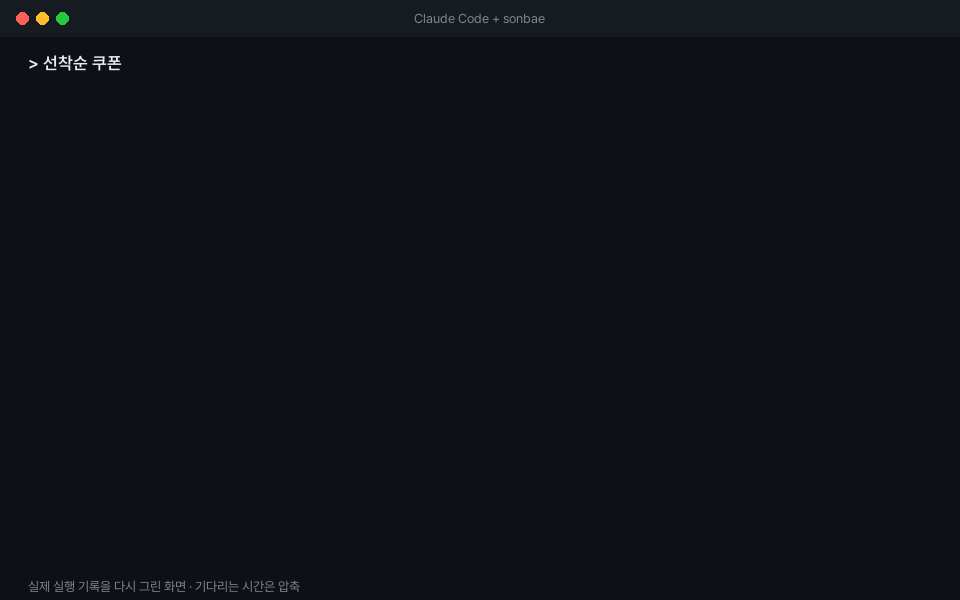

<h1 align="center"></h1>

<p align="center"><b>이 문제, 선배들은 어떻게 풀었지?</b></p>

<p align="center">국내 IT 기업 기술 블로그의 실제 해결 사례를<br>코딩 에이전트(Claude Code, Cursor 등)가 찾아 쓰게 하는 MCP 서버</p>

<p align="center">토스 · 우아한형제들 · 카카오 · 카카오페이 · 네이버 D2 · LY · 컬리 · 올리브영<br>2023-09 이후 글 1,200여 편에서 뽑은 사례 1,300여 개 · 매주 갱신</p>


<p align="center"></p>

<br>

## 웹 검색으로 사례를 찾으면

에이전트에게 "국내 기업 사례 찾아 줘"라고 하면 웹 검색 상위에 걸린 SEO 블로그, 커뮤니티 글, 여러 글을 짜깁기한 요약을 근거로 가져옵니다. sonbae는 **국내 기업 기술 블로그에서만**, **원문에 실제로 있는 근거와 함께** 사례를 찾아 줍니다.

| | 에이전트 + 웹 검색 | 에이전트 + sonbae |
| --- | --- | --- |
| 출처 | SEO 블로그, 커뮤니티 글, 짜깁기 요약이 섞임 | 8개 기업 기술 블로그만 |
| 근거 | 에이전트가 읽은 페이지의 요약 (검증 없음) | 원문 발췌. 원문에 실제로 있는지 코드로 검증 |
| 형태 | 글마다 제각각 | 문제 상황 / 해결 방법 / 성능·운영 포인트 / 버린 대안 |
| 사례가 없을 때 | 검색 결과는 늘 나와서 관련 낮은 글이 섞이기 쉬움 | 관련도 기준에 못 미치면 "결과 없음" |
| 집계 | 어려움 | "메시징 문제에 어떤 기술을 많이 썼나" 같은 기술·문제별 집계 |


## 설치

[uv](https://docs.astral.sh/uv/getting-started/installation/)와 [Git](https://git-scm.com/downloads)이 필요합니다.

```bash
uv tool install git+https://github.com/zie-ning/sonbae
claude mcp add --scope user sonbae -- sonbae
```

Claude Code에서 `/mcp`를 입력해 `sonbae`가 연결됐는지 확인하면 끝입니다. 첫 질문 때 검색 DB(약 15MB)를 내려받느라 10초쯤 늦을 수 있습니다.

<details>
<summary><b>Cursor·다른 클라이언트에 등록하기</b></summary>

**Cursor**: `~/.cursor/mcp.json`(모든 프로젝트) 또는 프로젝트의 `.cursor/mcp.json`에 추가합니다.

```json
{
  "mcpServers": {
    "sonbae": {
      "command": "sonbae"
    }
  }
}
```

**다른 MCP 클라이언트**: stdio 서버를 지원하면 `sonbae` 명령을 등록하면 됩니다. 클라이언트가 명령을 찾지 못하면 `uv tool dir --bin`이 알려 주는 폴더의 전체 경로(Windows는 `sonbae.exe`)를 쓰세요.

Claude Code의 `--scope user`는 모든 프로젝트에서 쓰는 설정입니다. 지금 프로젝트에서만 쓰려면 빼세요.

</details>

<details>
<summary><b>Voyage API 키로 검색 품질 높이기 (권장)</b></summary>

키가 있으면 표현이 달라도 뜻이 같은 사례를 찾고, DB에 없는 주제는 "결과 없음"으로 더 잘 거릅니다(평가셋 기준 상위 5건 안 정답 비율 0.55 → 0.75). 키가 없어도 단어로 찾는 검색은 그대로 됩니다.

1. [Voyage AI 대시보드](https://dashboard.voyageai.com/)에서 가입하고 API keys에서 키를 만듭니다. 계정마다 무료 토큰(2억)이 있고, 검색 한 번에 약 3만 토큰(무료 한도를 넘으면 약 $0.0015)을 씁니다. 결제 수단을 등록하지 않으면 분당 호출이 제한돼 검색이 키 없는 방식으로 대체될 수 있습니다.
2. 등록할 때 `VOYAGE_API_KEY` 환경 변수로 넣습니다.

```bash
claude mcp add --scope user sonbae -e VOYAGE_API_KEY=<키> -- sonbae
```

Cursor는 `"env": { "VOYAGE_API_KEY": "<키>" }`를 서버 설정에 추가합니다.

키를 설정하면 `search`의 검색어와 후보 항목 요약(DB에 있는 요약문)이 Voyage API로 전송됩니다. 대화 내용이나 작업 중인 코드는 보내지 않습니다. Voyage 호출이 실패하거나 8초 넘게 걸리면 단어로 찾는 방식으로 대신 검색하고 결과에 그 사실을 표시합니다.

</details>

## 이렇게 물어보세요

평소처럼 질문하면 에이전트가 알아서 sonbae를 씁니다.

- **설계를 시작하기 전에**: "결제 API 멱등성을 설계하려는데, 국내 기업들은 어떻게 했어?"
- **기술을 고를 때**: "메시지 큐로 Kafka와 RabbitMQ 중 고민 중이야. 실제 도입 사례를 비교해 줘."
- **경향을 볼 때**: "캐싱 문제에 어떤 기술 사례가 많아?"
- **직접 부르기**: `/sonbae 선착순 쿠폰` (Claude Code에서는 `/mcp__sonbae__sonbae`). 사례를 찾아 "참고 사례"와 "제안"으로 나눠 답합니다.

| 도구 | 하는 일 |
| --- | --- |
| `search` | 문제 상황·주제로 사례 검색 (최대 10건). 문제 유형·도메인·기술 필터 |
| `get_details` | 사례의 전체 내용, 필드별 원문 발췌, 원문 링크 (한 번에 5건) |
| `aggregate` | 기술·문제 유형·도메인·회사·버린 대안별 사례 수 |


## 데이터 출처와 저작권

- 원문의 저작권은 각 회사에 있습니다. 이 저장소와 배포 DB에는 원문 전체가 없고, LLM이 쓴 요약, 필드당 1~2문장의 원문 발췌, 원문 링크만 있습니다. 에이전트가 사례를 소개할 때는 회사명과 원문 링크를 함께 밝히도록 안내합니다.
- 수집할 때는 크롤러임을 밝히는 User-Agent를 쓰고, robots.txt를 지키며, 요청 사이에 간격을 두었습니다.
- **삭제 요청**: 블로그 운영 측에서 자사 글이 포함되지 않기를 원하면 [GitHub 이슈](https://github.com/zie-ning/sonbae/issues)로 알려 주세요. 해당 항목을 배포 DB에서 빼겠습니다.

## 라이선스

코드는 [MIT 라이선스](LICENSE)입니다. 블로그 글에서 나온 데이터(요약, 발췌, 링크)는 MIT 라이선스 대상이 아니며, 원문의 권리는 각 회사에 있습니다.
